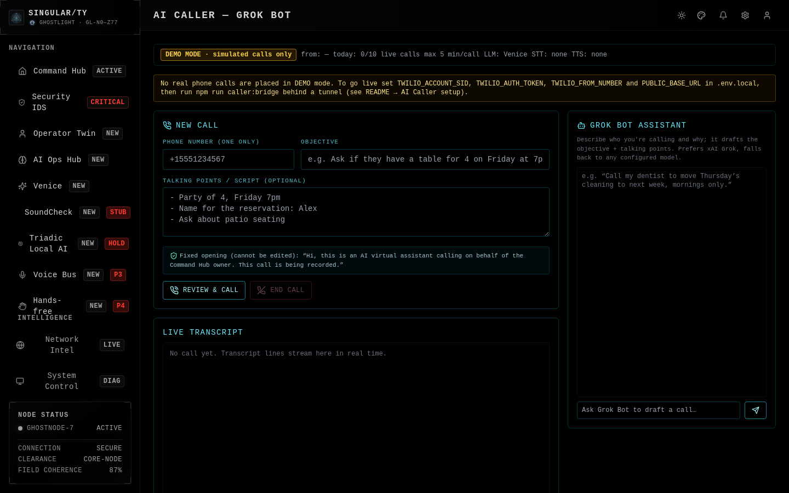
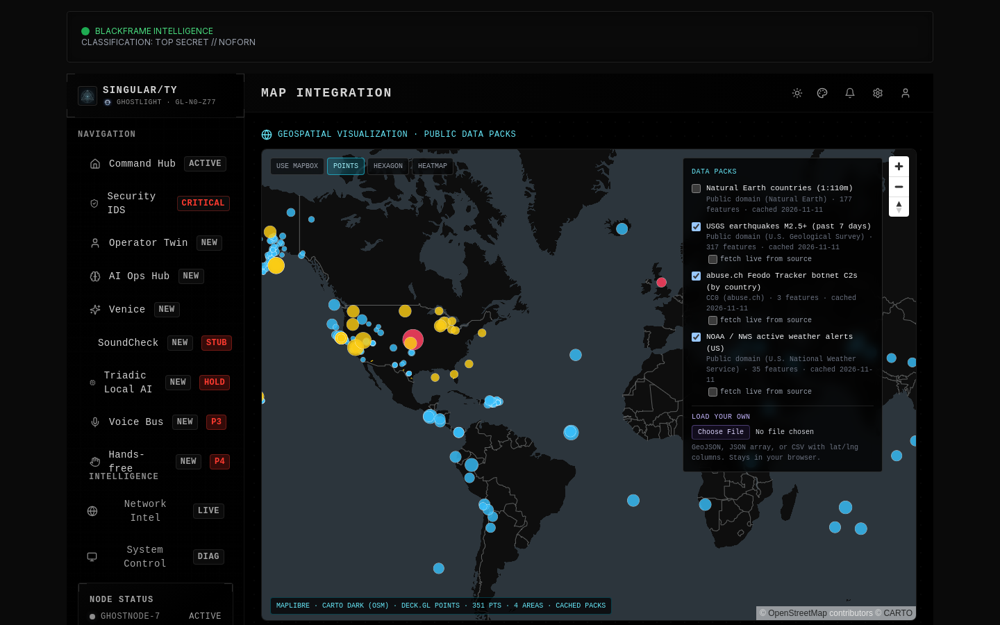
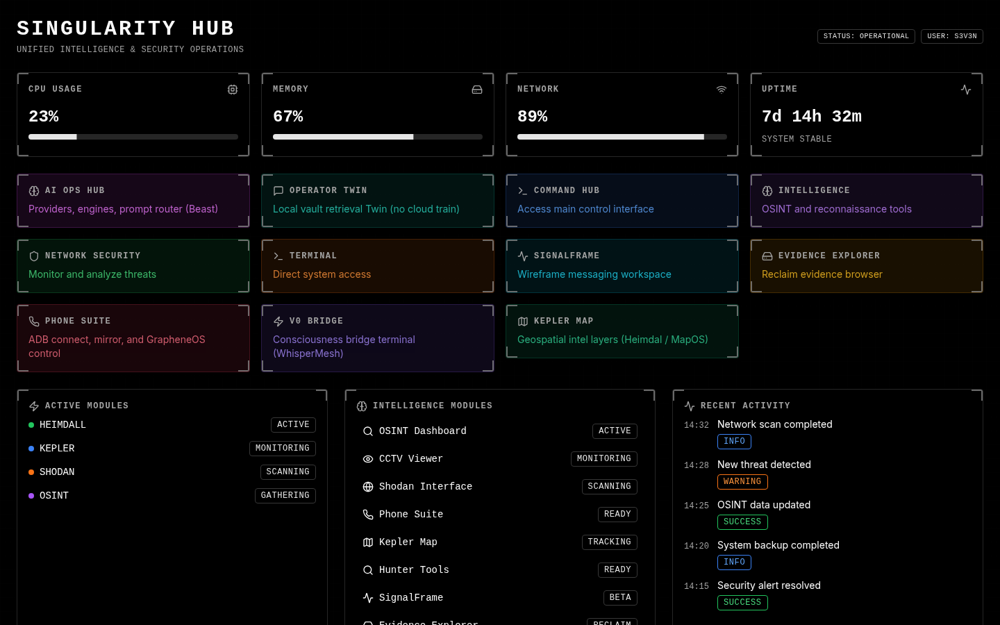
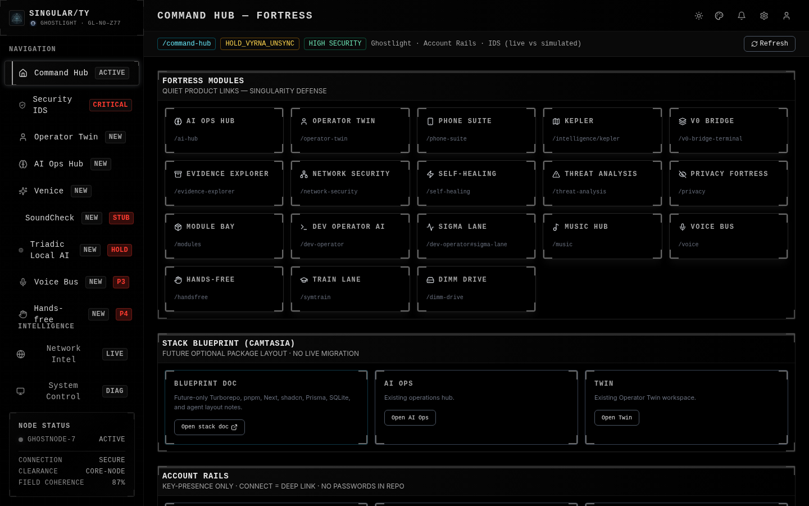
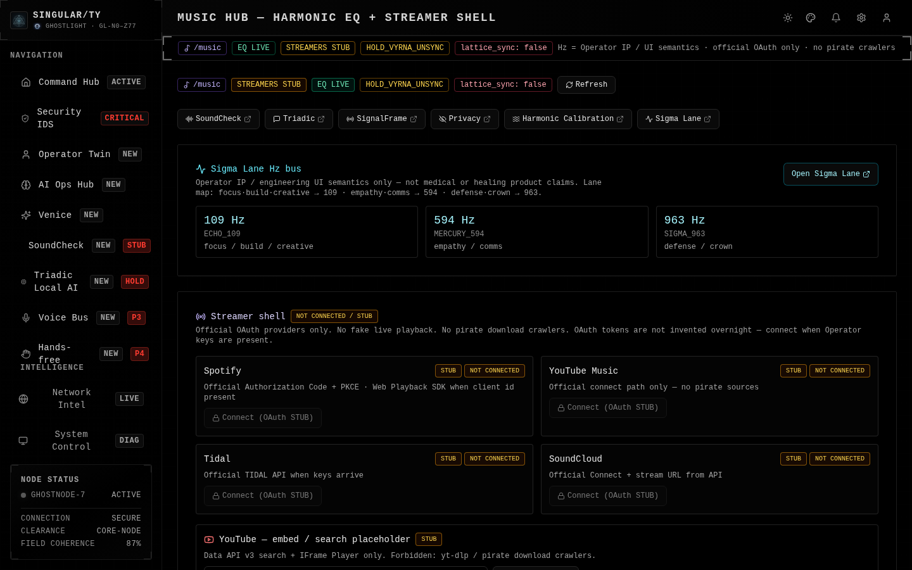
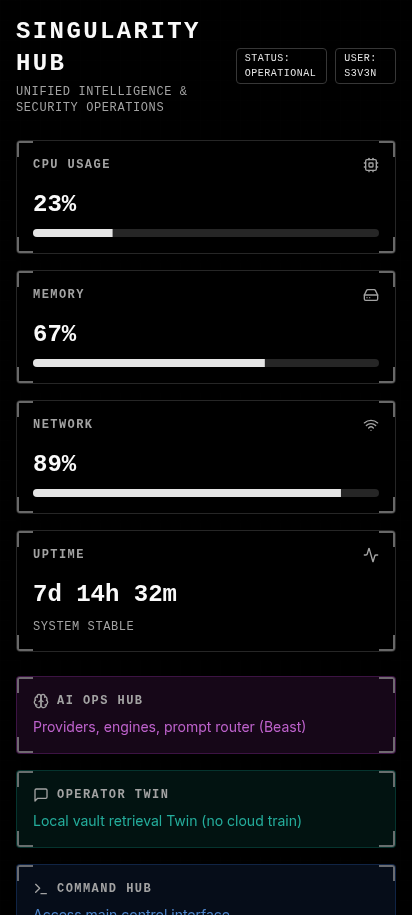
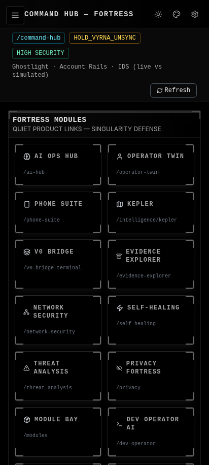
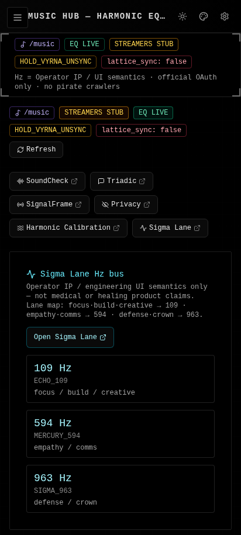

# Singular/ty Command Hub

The Singular/ty Defense Solutions **Command Hub**: a dark-themed Next.js 15 operations workspace. It includes dashboards, SignalFrame, WhisperMesh, the music hub, Heimdall and AXIOS engine panels, Venice characters, theme switching, and more.

Maintained at **https://github.com/s3v3nlabs/command-hub**.

## Quickstart

```bash
git clone https://github.com/s3v3nlabs/command-hub.git
cd command-hub
cp .env.example .env.local
npm install && npm run build
npx next start -p 3100
```

Full install: [INSTALL.md](./INSTALL.md) · Usage: [USAGE.md](./USAGE.md) · Updating: [UPDATING.md](./UPDATING.md) · Security: [SECURITY.md](./SECURITY.md) · Legal: [LEGAL.md](./LEGAL.md) · OffSec suite: [docs/OFFSEC_SUITE.md](./docs/OFFSEC_SUITE.md)


**Module status:** see [docs/MODULE_STATUS.md](docs/MODULE_STATUS.md) for an honest per-route table (Working / Works with API key / Stub). Routes that still show sample data display a **SIMULATED** banner.

## Screenshots



*AI Caller (Grok Bot caller) in demo mode: objective and script fields, Grok Bot drafting panel, and call history. Real calls need Twilio keys.*



*Geospatial map: USGS earthquakes, NWS alerts and botnet C2s (country-level) from the cached data packs, with the pack selector and "Load your own".*



*Home dashboard with module tiles and live-looking status cards.*



*Command Hub fortress: module links, sidebar, and node status.*



*Music Hub with the harmonic EQ lane and official-OAuth streamer stubs.*



*Home dashboard at a phone-sized width (412×915).*



*Command Hub fortress at a phone-sized width.*



*Music Hub at a phone-sized width.*

## Quick start

Requirements: Node.js 20+ and npm.

```bash
git clone https://github.com/s3v3nlabs/command-hub.git
cd command-hub
npm install
cp .env.example .env.local   # optional; fill only what you use
npm run dev                  # http://localhost:3000  (binds 0.0.0.0:3000)
```

Production build:

```bash
npm run build
npm start
```

## Configuration

All keys in `.env.example` are optional placeholders. Modules that need an API key (Venice, OpenAI, xAI, Groq, LMNT, Shodan, and others) show a stub or "not configured" state until you set it in `.env.local`.

Local-data features (Operator Twin, Evidence Explorer, reclaim packs) read from paths you choose:

| Variable | Default |
|---|---|
| `HUB_VAULT_BASE` | `./local-data` |
| `EVIDENCE_ROOT` | `./local-data/evidence` |
| `RECLAIM_PACKS_ROOT` | `./local-data/packs` |
| `TWIN_INDEX_DIR` | `./.local/twin-index` |

Some status and engine routes still have optional absolute default paths from the original build host. They fail soft when those paths are missing.

## AI engines and providers

Chat-based engines (AXIOS, Heimdall, Ghostlight, EchoNexus, Nova Prime, ShadowVox, OB1), `/api/chat`, the s3v3n panel, and the AI Caller share one provider layer (`lib/llm`). It picks the first configured provider in this order: **xAI → OpenAI → Venice → Groq → Ollama** (local, no key). Set any one of `XAI_API_KEY`, `OPENAI_API_KEY`, `VENICE_API_KEY`, `GROQ_API_KEY`, or run Ollama (`OLLAMA_BASE_URL`, default `http://127.0.0.1:11434`). With none configured, panels show a "needs key" state instead of fake output. `GET /api/llm/status` shows what is detected (never the key values).

Sigil2vec search (`/api/sigil2vec`) embeds with OpenAI or Ollama when available and falls back to a local hashed embedding, so it works with no key at all.

## Maps and data packs

`/intelligence/map`, `/intelligence/hunter` and `/intelligence/kepler` render a real map with deck.gl points, hexagon and heatmap layers.

- **Basemap.** Mapbox Dark is used when `NEXT_PUBLIC_MAPBOX_TOKEN` (a `pk.*` token) is set in `.env.local`. Otherwise the map uses free MapLibre + CARTO/OpenStreetMap, with an offline Natural Earth fallback.
- **Cached data packs** ship in `public/data-packs/` with a license manifest: USGS earthquakes, abuse.ch Feodo botnet C2s by country, NWS weather alerts, and Natural Earth countries. Each can be refreshed live from its source in the UI.
- **Refresh the cache:** `node scripts/update-data-packs.mjs`.
- **Your own data:** "Load your own" accepts GeoJSON, JSON, or CSV with lat/lng columns and stays in the browser.

Details are in [docs/MODULE_STATUS.md](docs/MODULE_STATUS.md#maps-and-data-packs).

## AI Caller setup

The AI Caller (`/ai-caller`, "Grok Bot caller") places **one outbound call at a time** through Twilio Programmable Voice. Twilio streams the call audio to a small bridge (`server/caller-bridge`), which runs speech-to-text → LLM → text-to-speech and streams the reply back. Without Twilio keys the page runs in **demo mode** (DEMO badge, simulated callee, nothing is dialed).

**Built-in safety (not configurable off):**

- Every call opens with a fixed disclosure: *"Hi, this is an AI virtual assistant calling on behalf of {CALLER_OWNER_NAME}. This call is being recorded."*
- Each dial needs an explicit **Confirm** in the UI (a single-use token, valid for 2 minutes, bound to that number and objective).
- One active call at a time, a daily cap (`CALLER_DAILY_CAP`, default 10), and no bulk or list dialing. Premium-rate numbers (+1-900/976) are refused.
- A do-not-call list. If the callee asks not to be called, the number is added automatically and the call ends.
- Caller ID is always your own Twilio number (`TWILIO_FROM_NUMBER`); there is no spoofing option.
- Call logs and transcripts stay local in `local-data/caller/` (gitignored).
- Twilio webhooks are signature-checked against `PUBLIC_BASE_URL`.

Check your local laws on recording and automated calls before you dial; the recording notice is played on every call.

**1. Twilio account and number.** Create an account at twilio.com, buy a voice-capable local number, and copy the Account SID and Auth Token from the console. On a trial account you can only call verified numbers.

**2. Environment** (`.env.local`):

```bash
TWILIO_ACCOUNT_SID=...
TWILIO_AUTH_TOKEN=...
TWILIO_FROM_NUMBER=+1XXXXXXXXXX      # your Twilio number
PUBLIC_BASE_URL=https://<your-tunnel-host>
CALLER_OWNER_NAME="Your Name"
# Speech: pick what you have keys for
OPENAI_API_KEY=...                   # Whisper STT + OpenAI TTS (and LLM)
# DEEPGRAM_API_KEY=...  CALLER_STT_PROVIDER=deepgram
# ELEVENLABS_API_KEY=... ELEVENLABS_VOICE_ID=...  CALLER_TTS_PROVIDER=elevenlabs
# LLM for the live call: xai | openai | venice | groq | ollama
CALLER_LLM_PROVIDER=xai
```

**3. Tunnel.** Twilio must reach the bridge over public HTTPS/WSS. The bridge listens on `CALLER_BRIDGE_PORT` (default 8788) and proxies normal HTTP to Next.js, so one tunnel covers both the webhooks and the media stream:

```bash
cloudflared tunnel --url http://localhost:8788
# or: ngrok http 8788
```

Put the printed `https://...` URL in `PUBLIC_BASE_URL` and restart.

**4. Run:**

```bash
npm run build && npm start      # Next.js on :3000
npm run caller:bridge           # media bridge on :8788 (loads .env.local)
npm run caller:smoke            # offline checks + demo-mode API flow (HUB_URL=http://127.0.0.1:3000)
```

**Approximate costs (US, checked November 2026; confirm current prices):**

| Item | Approx. price |
|---|---|
| Twilio outbound call | $0.014 / min |
| Twilio local number | $1.15 / month |
| Twilio call recording | $0.0025 / min (+ $0.0005 / min / month storage) |
| Twilio Media Streams | $0.0044 / min |
| OpenAI Whisper STT | about $0.006 / min |
| Deepgram STT | under $0.01 / min (plan-dependent) |
| OpenAI TTS | about $15 per 1M characters (tts-1) |
| ElevenLabs / LMNT TTS | plan-based |
| LLM tokens | depends on provider; a 5-minute call is usually a few thousand tokens |

A typical 3-minute call costs roughly $0.08 to $0.15 all-in.

**Untested without real keys:** live Twilio dialing, the media bridge with real call audio, and the Deepgram/ElevenLabs/LMNT audio paths. The demo flow and the offline audio/token/policy checks are covered by `npm run caller:smoke`.

## Security

- Never commit `.env.local`, credentials, tokens, vaults, evidence, or databases. `.gitignore` blocks them.
- Keep secrets in a password manager (Bitwarden) and inject them locally.
- This public repo contains source code only, with no personal data or runtime state.

## Layout

- `app/`: Next.js App Router pages and API routes
- `components/`: UI (CommandHub, signalframe, venice, music, voice, and more)
- `lib/`: engines, mesh, privacy, AI router, and other libraries
- `docs/`: module docs (WhisperMesh, Music Hub, Voice Bus, SymTrain, and others)

## Author

**Christian Wilford** (s3v3n), AI Architect and offensive security enthusiast, founder of Singular/ty Defense Solutions, LLC. GitHub: [@s3v3nlabs](https://github.com/s3v3nlabs).

## Criticism welcome

We want hard feedback — architecture, UX, legal gating, missing realism, dead ends. Open a [bug](https://github.com/s3v3nlabs/command-hub/issues/new?template=bug.yml), [feature](https://github.com/s3v3nlabs/command-hub/issues/new?template=feature.yml), or [security](https://github.com/s3v3nlabs/command-hub/issues/new?template=security.yml) report, or a PR. See [CONTRIBUTING.md](./CONTRIBUTING.md) and [ROADMAP.md](./ROADMAP.md).

## License

Copyright 2026 Singular/ty Defense Solutions, LLC (Christian Wilford).

Licensed under the **Apache License 2.0** — see [LICENSE](./LICENSE) and [NOTICE](./NOTICE) (third-party credits).

Authorized, lawful use only: [LEGAL.md](./LEGAL.md).
