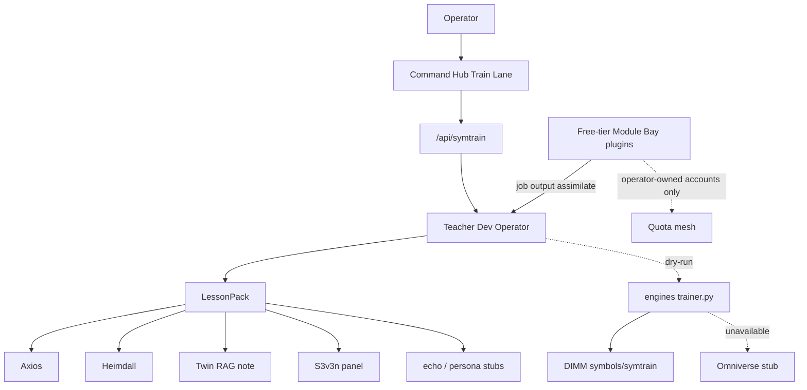

# Σ3D-SYMTRAIN — Train Lane (hub)

**Routes:** `/symtrain` · `/api/symtrain` · `/api/train` (alias) · chip on Command Hub + Dev Operator  
**Engines:** `/workspace/singular-ty-engines/symtrain/`  
**Hold:** `HOLD_VYRNA_UNSYNC` · `lattice_sync: false`  
**Mesh:** dry-run (widget skipped → no paid pods, no keys assumed)  
**Omniverse:** optional | unavailable (stub adapter only)

## Honesty

Designed from vault `triadic_relearn_2026-09-23/ARCHITECTURE.md` (LoRA/CLIP/diffusion/CUDA; RP-06 TRAIN; `ghost-symtrain`).  
This reclaim does **not** claim a prior runnable pack or Omniverse license.

## Architecture

## Quota mesh / free-tier peers

| Rule | Meaning |
|------|---------|
| Operator-owned only | Bind Module Bay plugins to accounts the Operator already owns |
| Perishable | **Jobs and pods** may be destroyed when idle |
| FORBIDDEN | Burner / trashable / perishable **ACCOUNT** farming |
| Dry-run default | No live paid pods from Train Lane |

Assimilate: `POST /api/symtrain { action: "assimilateJob", provider, jobId, summary, accountMode: "operator-owned" }`  
→ Teacher LessonPack → optional push to students.

## API

| Action | Role |
|--------|------|
| `GET` / `status` | Teacher badge, roster, Omniverse, mesh, free-tier plugins |
| `dryRunTrain` | Engines or TS fallback; writes lesson under DIMM |
| `emitLesson` / `pushLessonToStudents` | Teacher bus |
| `strain` | drift / miss / reclaim quiz / pink-brown |
| `setTeacher` | Default `dev-operator` |
| `assimilateJob` | Job output → Teacher lesson (policy-checked) |

## See also

- `docs/TEACHER_STUDENT.md`
- engines `singular-ty-engines/symtrain/README.md`
- `docs/GPU_MESH.md` (peers remain stubs until Operator enables)
- `docs/WHISPERMESH_PROXY_LORA.md` (proxy-chain ≠ mesh LoRA; LoRA train-lane is DRY-RUN/STUB)
