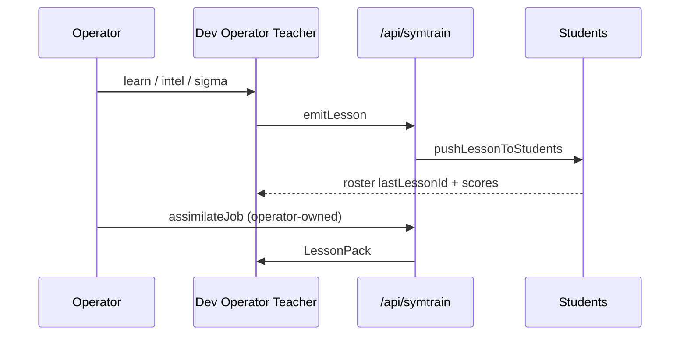

# Teacher → Student training bus

**Default Teacher:** Dev Operator (`lib/train/roles.ts`)  
**Students:** axios · heimdall · twin · s3v3n-panel · echo · persona-stub  
**Hold:** `HOLD_VYRNA_UNSYNC` · never claim Vyrna lattice sync  
**Privacy:** Prefer Privacy Fortress encrypt + DIMM `symbols/symtrain/`

## How the Operator uses it

1. Open **Train Lane** from Command Hub chip or `/symtrain` (also panel on `/dev-operator#train-lane`).
2. Teacher badge shows **Dev Operator**. Roster lists students + last lesson id + strain scores.
3. Chat/learn on Dev Operator with **SYMBOLIC_FAST** → auto `teacher.emitLesson` + push to students.
4. Hive BIG intel → also emits a train LessonPack (defense notes only).
5. Manual: **Emit + push**, **dryRunTrain**, or **Strain** drills.
6. Free-tier job finished on an **Operator-owned** Module Bay mesh plugin → `assimilateJob` into a Teacher lesson.
7. Omniverse stays **unavailable** until a real SDK/license exists. Mesh stays **dry-run** until keys + intentional enable.

## Strain modes

| Mode | Intent |
|------|--------|
| `drift_inject_retune` | Mild drift → retune Δt≈0 |
| `symbolic_miss_drill` | Reclaim missing glyph cue |
| `adversarial_reclaim_quiz` | Defense/privacy quiz (no exploits) |
| `pulse_pink_brown` | Pink explore / brown long-wander scores |

## Hard forbid

**No burner / trashable / perishable ACCOUNT farming.**  
Perishable means **jobs/pods only**. Free-tier peers are Module Bay plugins on accounts the Operator owns.

## Lib map

| File | Role |
|------|------|
| `lib/train/roles.ts` | Teacher + student registry |
| `lib/train/lessonStore.ts` | Persist LessonPack (encrypt / DIMM) |
| `lib/train/teacher.ts` | emitLesson / emitFromSymbolicLearn / emitFromHiveIntel |
| `lib/train/student.ts` | apply prefs / system-prompt nudge / Twin note |
| `lib/train/strain.ts` | Strain drills → scores |
| `lib/train/assimilate.ts` | Job output → Teacher + quota policy |
| `lib/train/adapters/*` | Thin lastLessonId recorders |

