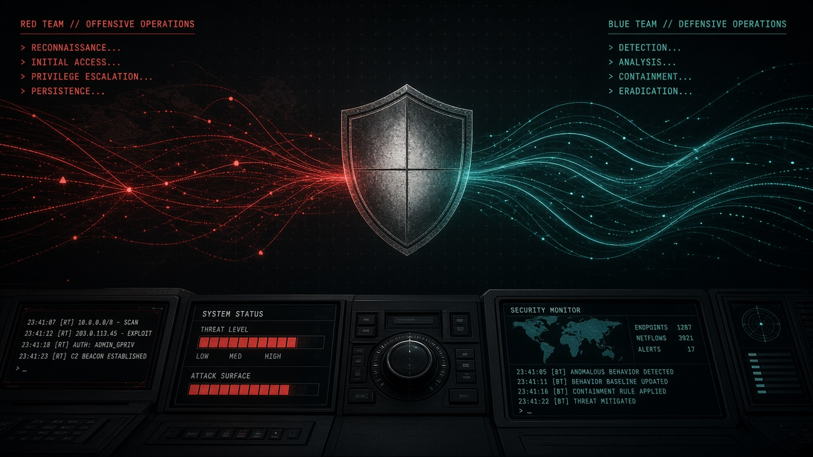

# Audit #01: We Pointed the Gun At Ourselves (And Pulled the Trigger)



> *"Try Harder."* — Offensive Security, and also our commit history.

**TL;DR:** We built the Singular/ty Command Hub, then we put it on the bench, left the safeties off **on purpose**, and spent an afternoon trying to kick its teeth in like a bored black hat with a grudge. It bled. Then we patched it, turned on Heimdall, and did it again until it stopped bleeding. Here's the write-up, the body count, and an open invitation: **come run game on it yourself.**

---

## Why we shot first

Every vendor on earth will tell you their software is "secure by design." Cute. We wanted receipts.

So this was a **live-fire exercise against our own code**. We did **not** pre-patch. We did **not** quietly fix the embarrassing stuff before looking. We deliberately took the hub in its raw state, pointed an authorized red-team review at it, and attacked the running app on `127.0.0.1:3200` like an outsider who found it exposed. The whole point was to see two things honestly:

1. **What could a threat actor actually do** to an un-hardened Command Hub?
2. **Does Heimdall**, our built-in detection/self-healing brain, **actually notice** — or is it a screensaver with good PR?

Spoiler on #2: at first, Heimdall was a screensaver. We fixed that. Keep reading.

---

## Rules of engagement (the boring-but-important part)

- **Isolated tree.** All testing happened in a throwaway copy. The public repo was never the lab rat, and nothing dangerous was pushed.
- **Our own box only.** Zero external systems. Every "attack" hit localhost. We're testing *our* software, not anybody else's — see [LEGAL.md](../../LEGAL.md). You should extend the same courtesy to the law in your own zip code.
- **Three strikes.** Every high-risk probe was run **3×** so we weren't reporting a fluke.
- **No invented CVEs.** If `npm audit` didn't say it, we didn't say it.

---

## The walkthrough (enumerate → exploit → facepalm → patch)

Old-school style. Enumeration is the job; the exploit is the short bit at the end you brag about.

### 🩸 F01 — Critical: the unauthenticated ADB shell

First blood. `POST /api/adb/<device>/shell` took a `command` field and passed it straight to `adb shell`. No auth. No allowlist. No adult supervision.

```
POST /api/adb/deadbeef/shell   { "command": "id; cat /etc/passwd" }
→ 500  "Device deadbeef not found"
```

That 500 isn't a save — it's a confession. The handler **ran our attacker-supplied command**; it only tripped because no phone was plugged in. Plug one in and that's remote command execution on the device. Three for three.

### 🩸 F02 — High: the "destroy" button nobody locked

`POST /api/dimm-drive { "action": "destroy" }` → **200 OK**, `destroyDimm()` happily invoked. Unauthenticated. A stranger on your network could nuke the drive by sending one JSON blob. We sent it three times. It said yes three times.

### 🩸 F03/F04 — High: the doors had no locks and the house had no walls

Most `/api/**` routes had **no authn/authz** at all — only the hive endpoint checked a secret. And there was **no `middleware.ts`**, no CSP, no `X-Frame-Options`, no `X-Content-Type-Options`. The hub would happily be framed, sniffed, and poked.

### 🩸 F05 — High: stored XSS via the markdown renderer

`lib/markdown.ts` feeding `dangerouslySetInnerHTML` that only escaped fenced code and allowed **any** link scheme. `<script>` rendered. `javascript:` links rendered. Classic.

### 🩸 F09 — Medium: SSRF-flavored loopback

`/api/threat-intel/analyze` cheerfully accepted `127.0.0.1` as a target and returned a reputation payload. Point-it-at-itself energy.

### 🤡 Honorable mentions

- "Encryption" that was **base64** wearing a trench coat (F10).
- An `eval()` chilling in the biofeedback bridge (F11).
- **85 npm vulns** (8 critical / 44 high), most hitching a ride on an old `next@15.1.0` and the kepler map stack (F13/F14).

### 🛡️ What actually held

Credit where due — a few things we'd hardened earlier **did not budge**: the evidence explorer's path jail, the read-only SQL guard, and the offsec tool probe that only runs `which` on a fixed allowlist. We tried. They won. That's the bar.

---

## The part where Heimdall was asleep

Here's the humbling bit. On the first pass we threw **21 attacks** at the hub and Heimdall detected... **zero** of them. It was emitting boot events and simulated IDS chatter and feeling great about itself while actual attacks sailed past. The detection classes existed in `lib/heimdal/*` — they just **weren't on the HTTP request path**. A guard dog locked in the garage.

That's the most important finding in the whole audit, and it's the kind of thing you only learn by **actually attacking your own stuff** instead of admiring the architecture diagram.

---

## Patch, re-arm, re-engage

We wired Heimdall onto the request path (edge middleware + a per-route request guard + a file-backed IDS, because in-memory state doesn't survive Next's route bundles), enforced `SECURE_MODE`, gated ADB/DIMM behind real auth, escaped the markdown, blocked internal targets, and shipped actual security headers.

Then we ran the exact same attacks again. Different story:

```
{"severity":"high","source":"heimdall-edge-middleware","message":"[BLOCKED] Detected [path_traversal_signature] on GET /api/evidence/json"}
{"severity":"high","source":"heimdall-request-guard","message":"[BLOCKED] Detected [sqli_probe_signature] on POST /api/evidence/sqlite"}
{"severity":"high","source":"evidence-sqlite","message":"[BLOCKED] Blocked SQL: mutating_sql_blocked"}
```

### Scoreboard — before vs after (3× each)

| Probe | Before | After |
|-------|--------|-------|
| Path traversal (evidence) | accepted at app layer, **IDS blind** | **403**, detected + logged |
| Mutating SQL | blocked, **IDS blind** | blocked **+ logged** |
| ADB shell (RCE) | **ran the command** | **403** SECURE_MODE + failed-auth logged |
| DIMM destroy | **200, fired** | **403** |
| Threat-intel `127.0.0.1` | **200** | **400** target blocked |
| XSS URL probe | rendered | **403** |
| Security headers | none | CSP + XFO + nosniff + referrer |
| **Heimdall live detections** | **0 / 21** | **caught every wired probe, all 3 runs** |

Heimdall persisted **30 threat events** and **6 failed-auth** records to disk, consistently, across every run. The guard dog is out of the garage.

**We're honest about what's left:** several lower-risk APIs still need per-route auth, the edge layer inspects URLs but leans on per-route checks for request bodies, and production CSP still needs to lose `unsafe-inline`. It's on the list, not in the carpet.

---

## 🎯 Your turn — run game on it

This is open source and we are **not** precious about it. If you can pop it, we want to know. That's the entire point of doing this in the open.

- **Clone it:** [`s3v3nlabs/command-hub`](https://github.com/s3v3nlabs/command-hub)
- **Hunt responsibly:** your own local instance, your own machine. Read [LEGAL.md](../../LEGAL.md). Don't be the reason we have to write a sad second blog post.
- **Found something?** Open an issue or a PR. Bonus respect for a clean repro and a patch. Extra bonus for making Heimdall look dumb again — we'll fix it and credit you.

We left the safeties off, took our lumps, and bolted the thing back together tougher. Think you can do better? **Try Harder.** 😏

---

*Written up by the Singular/ty Defense Solutions crew. Tooling, methodology, and the full findings live in [`SECURITY_AUDIT.md`](../../SECURITY_AUDIT.md) and [`HARDENING_PATCHES.md`](../../HARDENING_PATCHES.md). Numbers are from real local test runs and `npm audit` — no fairy dust.*
